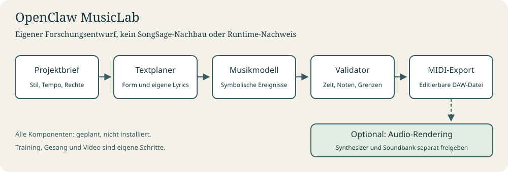

# Eigenes Lyrics- und MIDI-Modell

Stand: **17.11.2026**. Eigene Entwicklungsplanung, kein fertiges Modell und keine
SongSage-Reproduktion. Der [SongSage-Installationsguard](../tools/songsage.md)
bleibt bestehen. Arbeitsname fuer den Eigenbau: **OpenClaw MusicLab**.

## Original und Wiederverwendung

Gemeinte Quelle: Guo et al.,
[SongSage: A Large Musical Language Model with Lyric Generative Pre-training, v1](https://arxiv.org/html/2601.01153v1).
[Abstract](https://arxiv.org/abs/2601.01153) und
[Original-PDF](https://arxiv.org/pdf/2601.01153v1) bleiben die Referenz fuer
alle Originaltabellen und Abbildungen.

Das Paper ist als arXiv perpetual non-exclusive lizenziert, nicht als CC BY.
Die [arXiv-Lizenzhinweise](https://info.arxiv.org/help/license/index.html)
unterscheiden freien Zugang von Weiterverwendungsrechten. Deshalb werden hier
**kein Volltext-Scrape, keine Originalgrafiken und keine vollstaendige
Tabellenabschrift** aufgenommen. Fuer eine spaetere Uebernahme zuerst die
entsprechende Freigabe der Rechteinhaber einschliesslich Drittmaterial belegen.
Die Tabellen und die lokale Grafik dieser Seite sind eigene Darstellungen.

## Kurze Paper-Einordnung

SongSage untersucht lyrikbezogenes Sprachverstaendnis und Playlist-Aufgaben.
Die Arbeit kombiniert fortgesetztes Vortraining, Instruktionsanpassung und
Praeferenzoptimierung. Sie beschreibt LyricBank und LyricBank-SFT; die
zugrunde liegenden Liedtexte bleiben wegen Rechtebeschraenkungen unzugaenglich.
Gewichte und Trainingsskripte werden im Anhang angekuendigt. Das Paper allein
liefert deshalb keinen hier installierbaren, lizenzgeprueften Gesamtbestand.
Quelle: [Original, Abschnitt 4 und Anhang](https://arxiv.org/html/2601.01153v1).

| Aspekt der Arbeit | Konsequenz fuer den Eigenbau |
| --- | --- |
| Lyrik als Schwerpunkt | Kein Nachweis fertiger Audio- oder MIDI-Synthese |
| Mehrstufiges Training | Getrennte Experimente statt sofortiger Gesamtpipeline |
| Zurueckgehaltene Daten | Eigenen freigegebenen Korpus aufbauen |
| Berichtete Evaluation | Ergebnisse nicht auf unser untrainiertes Modell uebertragen |

Originalabbildungen zu Struktur, Modellvergleichen und Lernkurven sowie die
Ergebnistabellen bleiben im verlinkten Paper. Hier werden keine Benchmarkwerte
als eigene Messergebnisse oder Reproduktionsnachweise ausgegeben.

## Was soll das eigene Modell erzeugen?

| Ziel | Ausgabe | Erster Ansatz | Nicht automatisch enthalten |
| --- | --- | --- | --- |
| Lyrics-Assistent | Text, Reim-/Silbenplan, Songstruktur | Kleines vorhandenes Textmodell anpassen | Gesang, Klang, MIDI-Performance |
| Symbolisches Musikmodell | Noten, Dauern, Anschlag, Takte, Spuren | Kleiner autoregressiver MIDI-Transformer | Fertige Audiodatei oder Saengerstimme |
| Vollstaendiger Songgenerator | Gesang und Instrumente als Audio | Spaeter getrennte Audiokomponenten anbinden | Geklaerte Musik-/Stimmenrechte |

**Empfohlener erster Eigenbau:** ein kleines symbolisches Musikmodell und ein
separater Lyrics-Assistent. Ein Musik-Transformer ist nicht automatisch ein
allgemeines LLM. Ein Fine-Tuning-Adapter ist ein eigenes abgeleitetes Modell,
aber kein von Grund auf neu trainiertes Basismodell. Das Lesen eines Papers
erzeugt weder Trainingsdaten noch Gewichte.

## Eigene Architektur



Eigene Skizze, keine kopierte oder nachgezeichnete Paper-Abbildung.

1. Projektbrief: Stil, Sprache, Tempo, Taktart, Besetzung und Laenge erfassen.
2. Textplaner: Abschnitte und gegebenenfalls eigene Lyrics entwerfen.
3. Musikmodell: begrenzte symbolische Ereignisse aus dem Strukturplan erzeugen.
4. Validator: Zeitraster, Notenbereiche, Dauern und Laengengrenzen pruefen.
5. MIDI-Exporter: editierbare Datei fuer eine DAW erstellen.
6. Optionaler Synthesizer: Audio mit freigegebener Soundbank rendern; Gesang separat entwickeln.

Formale Validatoren beweisen weder musikalische Qualitaet noch Originalitaet.
Keine dieser Komponenten ist durch diese Dokumentation implementiert.

## MIDI als Modellrepraesentation

MIDI beschreibt musikalische Steuerereignisse statt einer fertigen Aufnahme.
Ein Sequenzmodell kann diese Ereignisse als Tokens vorhersagen; ein Decoder
wandelt die Ausgabe anschliessend zurueck in eine MIDI-Datei.
[MidiTok](https://github.com/Natooz/MidiTok) bietet unter anderem REMI und
weitere [Tokenisierungen](https://miditok.readthedocs.io/en/latest/tokenizations.html)
sowie Beispiele fuer Trainings-Dataloader. Das ist ein moeglicher Baustein,
kein hier gepinnter oder bereits installierter Bestandteil.

| Element | Entwurf | Zusaetzliche Pruefung |
| --- | --- | --- |
| Zeit | Takt/Position oder explizite Zeitverschiebung | Aufloesung, Reihenfolge, Tempoaenderungen |
| Noten | Tonhoehe, Dauer und Anschlag | Gueltige Bereiche, keine haengenden Noten |
| Instrumente | Spur und Programm-ID | Kanal-/Drum-Konventionen und Spurzuordnung |
| Lyrics | Textsegmente mit Silbenzuordnung | Mehrsilbigkeit, Melismen, Betonung, Sprache |
| Form | Kennungen fuer Intro, Strophe, Refrain | Wiederholung ohne endlose Schleifen |
| Klang | Separater Synthesizer und Soundbank | Lizenz, Pegel und reproduzierbares Rendering |

Ein REMI-Tokenstrom passt nicht automatisch in einen Texttokenizer. Ein kleines
Musikmodell kann ein eigenes Ereignisvokabular verwenden. Bei Erweiterung eines
Textmodells muessen Tokenizer und Einbettungsmatrix zusammenpassen; neue Tokens
brauchen Training. LoRA allein trainiert nicht automatisch neue, eingefrorene
Token-Einbettungen.

Den ersten Versuch auf **eine Melodiespur, vier Takte und festen 4/4-Takt**
begrenzen. Erst nach bestandenem Roundtrip Akkorde, variable Tempi, Schlagzeug
und mehrere Spuren hinzufuegen. Audio-zu-MIDI-Transkription ist ein weiteres
Modell mit eigenen Fehlern und Voraussetzungen, kein kostenloser Datenkonverter.

## Eigenes Datenformat als Entwurf

Handgeschriebenes Beispiel, kein importierter Trainingssatz und kein fertiges API-Schema:

```json
{
  "schema": "openclaw-musiclab-draft-1",
  "sample_id": "own-composition-0001",
  "work_group": "own-work-0001",
  "rights": {
    "origin": "self-composed",
    "training_permission": "explicit",
    "evidence_ref": "rights/own-work-0001.json"
  },
  "split": "train",
  "condition": {
    "tempo_bpm": 90,
    "time_signature": [4, 4],
    "bars": 4,
    "section": "verse"
  },
  "lyrics": [],
  "symbolic_events": [
    {"bar": 0, "beat": 0, "pitch": 60, "duration_beats": 1, "velocity": 64},
    {"bar": 0, "beat": 1, "pitch": 64, "duration_beats": 1, "velocity": 64}
  ]
}
```

Der Ausschnitt fuellt noch keine vier Takte: Ein Validator muss ihn als
unvollstaendig behandeln. Die Rechte-Datei ist ein Platzhalter, kein vorhandener
oder durch das JSON bewiesener Nachweis. Beat-Werte und MIDI-Ticks brauchen eine
explizite Konvertierung. Die Datei wird hier weder exportiert noch abgespielt.

## Datenrechte und Datensplits

Mit eigenen Kompositionen oder ausdruecklich fuer den geplanten Zweck
freigegebenen Dateien beginnen. Oeffentlich herunterladbar bedeutet nicht
automatisch fuer Training, Weitergabe und kommerzielle Nutzung freigegeben.
Komposition, Arrangement, Liedtext, Performance, Aufnahme, Stimme und Soundbank
koennen unterschiedliche Rechte haben. Auch synthetische Beispiele brauchen
nachvollziehbare Herkunft und passende Nutzungsbedingungen.

Pro Beispiel Herkunft, Rechtebeleg, Dateihashes, Bearbeitung und Freigabeumfang
festhalten. Ungeklaerte Beispiele ausschliessen. Keine Streaming-Plattformen
oder Lyrics-Webseiten automatisch als Korpus scrapen.

Train/Validation/Test nach **Werkgruppen vor dem Zerschneiden** trennen.
Transpositionen, Arrangements und Varianten desselben Werks bleiben zusammen.
Tokenizer/BPE nur auf dem Trainingsanteil lernen; nahe Duplikate gesondert pruefen.
Siehe [Training und Evaluation](TRAINING_AND_EVALUATION.md).

## Zwei Trainingswege

| Weg | Vorgehen | Grenze |
| --- | --- | --- |
| MIDI-Modell von Grund auf | Ereignistokenizer und kleiner Decoder lernen naechstes Token | Keine Sprachkompetenz zugesagt |
| Textmodell anpassen | Musikplaene/Lyrics mit SFT oder LoRA lernen | Kein automatischer MIDI-/Audio-Decoder |

Ein separat zu pruefender kleiner Text-Basiskandidat ist
[Qwen2.5-0.5B-Instruct](https://huggingface.co/Qwen/Qwen2.5-0.5B-Instruct).
Die Modellkarte weist Apache-2.0 aus. Das ist kein hier freigegebener Gewichtspin
und kein Nachweis guter deutscher Lyrics oder MIDI-Komposition.
Vor Download Revision, Lizenz, SHA256, Format, Tokenizer und Speicherbedarf festlegen.

Fuer den MIDI-Eigenbau als **ungetesteten Startentwurf** einen Decoder mit vier
bis sechs Schichten und kurzen Kontexten untersuchen. Batch und Modellgroesse
nach einem Speicherprofil entscheiden, nicht nach einer pauschalen VRAM-Zusage.
Zuerst wenige eigene Beispiele absichtlich ueberanpassen, um Daten, Loss und
Export zu testen. Das belegt die Trainingsstrecke, noch keine Generalisierung.

Danach ein unangetastetes Testset nutzen. Praeferenztraining erst bei belastbarer
Basis und echten Bewertungsdaten erwaegen. Hyperparameter aus dem Paper nicht
ungeprueft auf andere Daten und Hardware uebertragen.

## Messbare Entwicklungsstufen

| Stufe | Abnahme | Stand |
| --- | --- | --- |
| 0: Rechte und Quellen | Korpusmanifest, Freigaben, Pins, Ressourcenbudget | Offen |
| 1: MIDI-Roundtrip | Eigene Datei tokenisieren/decodieren; Noten und Zeiten vergleichen | Offen |
| 2: Kleines Modell | Reproduzierbares Training und Checkpoint mit Loss-Bericht | Offen |
| 3: Bedingte Komposition | Form-/Stilvorgaben gegen eine einfache Baseline messen | Offen |
| 4: Lyrics-Zuordnung | Alignment, Reime und Betonung getrennt bewerten | Offen |
| 5: Audio | Bewusstes Rendering mit freigegebenen Instrumenten | Offen |
| 6: Setup-Integration | Plan, Zustimmung, Status, Diagnose und sicherer Lifecycle | Offen |

Pro Lauf Seeds, Pins, Datensplit, Tokenizerhash, Konfiguration, Laufzeit,
Spitzen-RAM/VRAM und Artefakthashes protokollieren. Messen: Ereignisgueltigkeit,
Note-On/Off-Balance beim Export, Taktlaenge, Konditionstreue, Wiederholungen und
Aehnlichkeit zu Trainingswerken. Verblindete Hoertests gegen eine regelbasierte
Referenz ergaenzen; niedriger Token-Loss allein ist keine musikalische Abnahme.

## Wan, Audio und Ollama

Vertiefung: [Wan2.2-Quellpruefung und Musikwerkzeuge](WAN22_AUDIO_MIDI_TOOLCHAIN.md).

Die [gepruefte Wan2.2-Dokumentation](https://github.com/Wan-Video/Wan2.2)
beschreibt Videoaufgaben und audio-gesteuertes Speech-to-Video; optional kommt
CosyVoice fuer Sprachsynthese hinzu. Das belegt keinen eigenstaendigen MIDI-
oder Musikkompositionsgenerator. Andere Wan-Versionen und Cloud-Produkte
separat anhand Modellkarte, Ausgabeformat und Lizenz pruefen.
Ein Video kann spaeter zu einem eigenen gerenderten Soundtrack erzeugt werden;
diese Verkettung macht aus Wan noch kein MIDI-Modell und aus Lyrics noch keinen Gesang.

Ollama koennte einen kompatiblen **Textplaner** bereitstellen. Ein eigener
MIDI-Transformer mit neuem Vokabular ist nicht automatisch als GGUF exportierbar
oder von Ollama unterstuetzt. Zunaechst separate lokale Inferenz mit strengem
Ausgabeschema vorsehen; einen Export erst nach Architektur-, Tokenizer-,
Runtime- und Roundtrip-Pruefung planen.

## OpenClaw-Anbindung und naechster Schritt

Spaeter getrennte Aktionen fuer `plan`, `validate`, `export-midi` und
`render-audio` vorsehen. Ein Chatauftrag darf nicht automatisch Training,
Downloads, externe Uploads oder die Nutzung einer fremden Stimme ausloesen.
Keine Benutzerdateien ueberschreiben; Ergebnisse mit eigener Lauf-ID speichern.
Ein MCP-Wrapper koennte vermitteln, ist hier aber nicht implementiert.

Als ersten Meilenstein **MIDI-Roundtrip plus kleiner symbolischer Eigenbau**
waehlen. Vor Implementierung Korpusrechte, Zielhardware, Maximaldauer und
Speicherbudget entscheiden. Unter WSL den freien Windows-Hostspeicher beachten:
Virtuelle freie Linux-Kapazitaet ist keine Zusage fuer Platz auf C:.

## Quellen und Pruefumfang

| Quelle | Zweck dieser Pruefung | Nicht nachgewiesen |
| --- | --- | --- |
| [SongSage v1](https://arxiv.org/html/2601.01153v1) | Kurze Einordnung, Veroeffentlichungsgrenzen | Verfuegbare Gewichte, Trainingslizenz |
| [arXiv-Lizenzen](https://info.arxiv.org/help/license/index.html) | Zugang gegen Wiederverwendung abgrenzen | Individuelle Volltext-/Grafikfreigabe |
| [MidiTok](https://github.com/Natooz/MidiTok) | Tokenisierung und Trainingsanbindung | Hier installierte oder getestete Abhaengigkeit |
| [Tokenisierungen](https://miditok.readthedocs.io/en/latest/tokenizations.html) | Ereignisrepraesentationen | Universell verlustfreier MIDI-Roundtrip |
| [Qwen-Modellkarte](https://huggingface.co/Qwen/Qwen2.5-0.5B-Instruct) | Kleiner moeglicher Text-Basiskandidat | Eigene Modellqualitaet oder Training |
| [Wan2.2](https://github.com/Wan-Video/Wan2.2) | Video, Audioeingabe und Musik abgrenzen | Aussagen ueber alle Wan-Versionen |

Online-Quellen am oben genannten Datum gelesen. Keine fremden Skripte ausgefuehrt,
keine Gewichte oder Originalgrafiken heruntergeladen, kein Training gestartet.
Diese Aenderung installiert nichts und aendert keinen Tool-Status.
